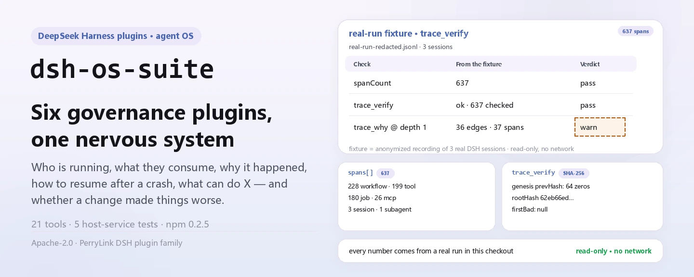
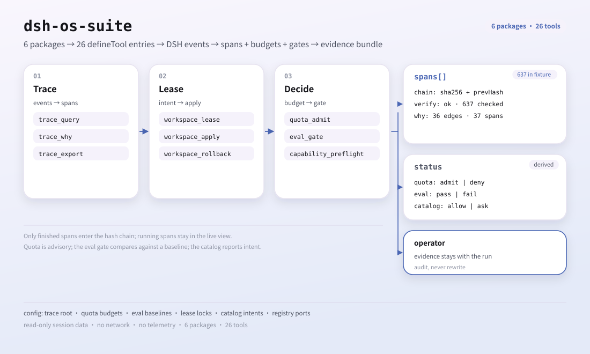

<div align="center">

<picture>
  <source media="(prefers-color-scheme: dark)" srcset="docs/assets/dsh-os-suite-hero-en-dark.webp">
  
</picture>

# dsh-os-suite

**Seis plugins de gobernanza para las capas que [DeepSeek Harness](https://github.com/deepseek-ai/deepseek-harness) (DSH) no trae: traza causal, leases de espacio de trabajo, cuotas consultivas, puertas de evaluación, catálogo de capacidades y registro de servicios.**

*Quién está corriendo, qué consume, por qué ocurrió algo, cómo reanudar tras un fallo, qué puede hacer X y si un cambio empeoró las cosas — 21 herramientas en seis paquetes con `defineTool`, lógica central sin red, 5 pruebas de integración con servicios del host, publicado como `0.2.5`.*

[English](README.md) · [简体中文](README-zh.md) · **Español** · [Português](README-pt.md) · [हिन्दी](README-hi.md)

[](https://github.com/PerryLink/dsh-os-suite/actions/workflows/ci.yml)
[](LICENSE)
[Seguridad](SECURITY.md) · [Contribuir](CONTRIBUTING.md) · [Changelog](CHANGELOG.md)

</div>

> **Proyecto comunitario. Sin afiliación, patrocinio ni respaldo de DeepSeek.**
> Apache-2.0. Sin SLA, sin garantía. MVP temprano, publicado como `0.2.5` en npm (2026-11-19).

DSH ya tiene los órganos de un agent OS — sesiones, herramientas, bucle del agente, sandbox, aprobaciones, jobs, equipos, worktrees, MCP. Lo que le falta es el **sistema nervioso**: quién está corriendo, qué consume, por qué ocurrió algo, cómo reanudar tras un fallo, qué puede hacer X y si un cambio empeoró las cosas. Estos seis paquetes cubren esa capa, no otra piel de UI ni búsqueda de archivos.

---

## Paquetes

| Paquete | Brecha | Herramientas |
|---|---|---|
| [`dsh-os-trace`](packages/dsh-os-trace/) | Auditoría causal y paquetes de evidencia a prueba de manipulación | `trace_query`, `trace_why`, `trace_export`, `trace_verify` |
| [`dsh-os-lease`](packages/dsh-os-lease/) | Intenciones de lease de espacio de trabajo y planes de transacción multiarchivo | `workspace_lease`, `workspace_apply`, `workspace_rollback`, `workspace_status` |
| [`dsh-os-quota`](packages/dsh-os-quota/) | Presupuestos consultivos de token/job/disco y decisiones de admisión | `quota_status`, `quota_set`, `quota_admit`, `quota_consume` |
| [`dsh-os-eval`](packages/dsh-os-eval/) | Puertas de evaluación de regresión: casos, líneas base, veredictos de CI | `eval_run`, `eval_gate`, `eval_report` |
| [`dsh-os-catalog`](packages/dsh-os-catalog/) | Catálogo de capacidades por intención para herramientas, plugins y MCP | `capability_search`, `capability_preflight`, `capability_register` |
| [`dsh-os-registry`](packages/dsh-os-registry/) | Registro local de servicios y puertos para servidores de desarrollo | `service_register`, `service_list`, `service_stop` |


<picture>
  <source media="(prefers-color-scheme: dark)" srcset="docs/assets/dsh-os-suite-flow-v5-dark.svg">
  
</picture>

*Estructura: seis paquetes → 21 herramientas → una capa de solo lectura; `trace_*` registra la cadena causal, `workspace_*` planifica y aplica cambios multiarchivo, `quota_*` decide la admisión, `eval_*` pone la puerta contra líneas base, `capability_*` responde qué puede hacer X y `service_*` rastrea puertos locales. Las etiquetas del diagrama son los nombres reales de herramientas y paquetes, así que la misma imagen sirve a los cinco idiomas.*

## Estado (2026-11-15)

- **276/276 pruebas pasan** (`npm test`; seis paquetes).
- **Protección de rama**: `main` exige PR, los checks CI/CodeQL y una rama actualizada; force push y borrado están bloqueados.
- **Procedencia del release**: los releases publicados en GitHub llevan un asset `.intoto.jsonl` generado a partir de las atestaciones de npm (manual desde `v0.2.4`, automático para releases futuros vía `.github/workflows/release-provenance.yml`).
- **Autenticación del release**: npm Trusted Publishing (OIDC), verificado con el release `v0.2.5`; el secret `NPM_TOKEN` heredado ya se eliminó. Pasos e historial: [`docs/trusted-publishing.md`](docs/trusted-publishing.md).
- **Integración con servicios del host**: cinco pruebas montan los paquetes reales de servicio de DSH `0.2.2-rc.3` (Cordis Context, ToolRuntime, NativeToolExecutor, SessionStore, SessionProjectionRegistry, SessionQuery, TokenMeter) y verifican la denegación de cuota, los spans de traza, las lecturas en vivo de eval y la presión del token-meter; ejecuta `npm run test:integration`.
- **Puerta de cobertura**: líneas 85%, funciones 80%, ramas 70% (`npm run test:coverage`).
- **21 herramientas** se registran vía `defineTool`; las seis entradas importan y hacen `apply()` bajo un contexto Cordis falso.
- **Nombres verificados**: `npm view <name>` → E404; búsqueda exacta de nombre en GitHub → 0 (2026-11-15). Ver [NAME-CHECK.md](NAME-CHECK.md).
- **Auditoría previa al release**: [AUDIT.md](AUDIT.md) (histórico, 0.1.x); los tres hallazgos se corrigieron en 0.2.x.
- **Instalación real verificada** en un `DSH_HOME` aislado: los seis tarballs se instalan vía `dsh plugin --profile web add`, y `--dump-config` lista las seis entradas.
- **Publicado**: los seis paquetes en `0.2.5` en npm (2026-11-19).

## Instalación

```sh
dsh plugin --profile web add dsh-os-trace
dsh plugin --profile web add dsh-os-lease
dsh plugin --profile web add dsh-os-quota
dsh plugin --profile web add dsh-os-eval
dsh plugin --profile web add dsh-os-catalog
dsh plugin --profile web add dsh-os-registry
```

## Inicio rápido


*Animado: la salida real de `node --test --test-reporter=tap` sobre los seis paquetes (288 pruebas), `test:integration` (5 pruebas) y `npm run check:docs` en este checkout el 2026-11-21. La sección de estado conserva su instantánea del 2026-11-15.*


```sh
npm install
npm test

# inspeccionar el tarball de un paquete sin publicarlo
cd packages/dsh-os-trace && npm pack --dry-run
```

Cada paquete incluye `src/`, `cordis.patch.yml`, `README.md`, `DESIGN.md`, `LICENSE`, y declara `dsh.bundle.patch` + `engines.dsh`.

## Reglas de diseño

- La lógica central (`src/core.js`) **no** importa ningún `@deepseek-ai/*`; las pruebas corren sin red.
- La entrada del plugin solo registra herramientas y llama al core.
- Cada herramienta declara `parameters` y `output` schemas explícitos.
- Las descripciones cuentan lo que el MVP hace de verdad; mocks y límites se declaran en el README de cada paquete.
- Sin red ni escrituras al sistema de archivos en el core; sin secretos.

## Licencia

Apache-2.0. Ver el `LICENSE` de cada paquete.
