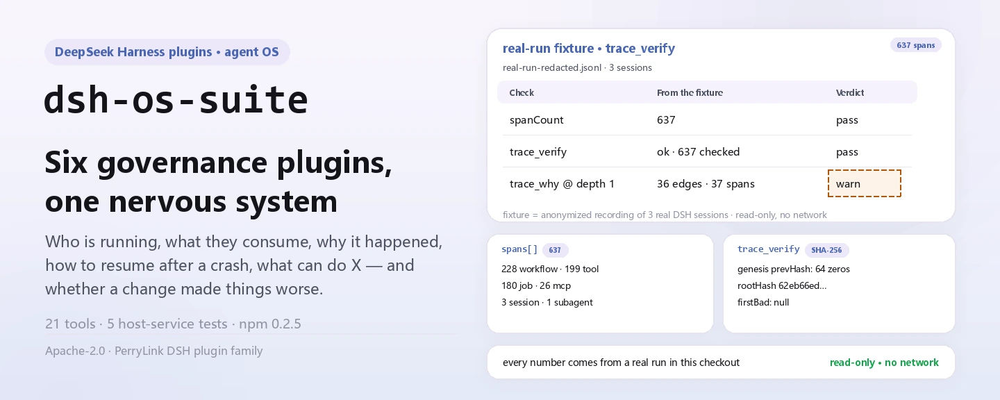
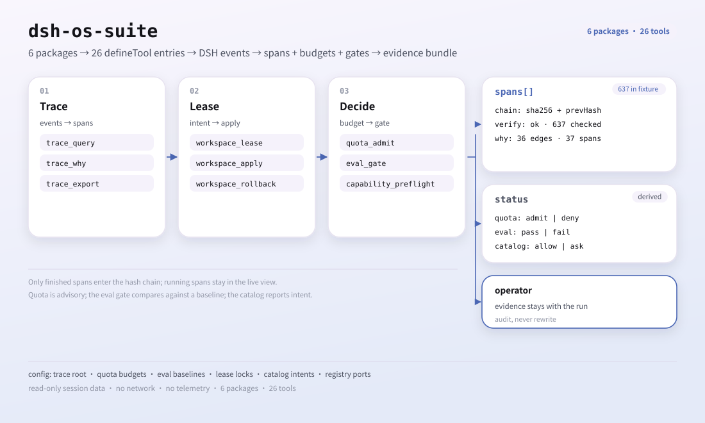

<div align="center">

<picture>
  <source media="(prefers-color-scheme: dark)" srcset="docs/assets/dsh-os-suite-hero-en-dark.webp">
  
</picture>

# dsh-os-suite

**DSH ([DeepSeek Harness](https://github.com/deepseek-ai/deepseek-harness)) की जिन परतों की कमी है, उनके लिए छह गवर्नेंस प्लगइन: कारण-आधारित ट्रेस, workspace leases, सलाहकारी कोटा, eval गेट, capability catalog और service registry।**

*कौन चल रहा है, क्या खपत कर रहा है, कोई बात क्यों हुई, crash के बाद कैसे जारी रखें, कौन X कर सकता है, और किसी बदलाव ने चीज़ें बिगाड़ीं या नहीं — छह `defineTool` पैकेजों में 21 टूल, core logic offline, 5 host-service integration टेस्ट, `0.2.5` के रूप में प्रकाशित।*

[English](README.md) · [简体中文](README-zh.md) · [Español](README-es.md) · [Português](README-pt.md) · **हिन्दी**

[](https://github.com/PerryLink/dsh-os-suite/actions/workflows/ci.yml)
[](LICENSE)
[सुरक्षा](SECURITY.md) · [योगदान](CONTRIBUTING.md) · [Changelog](CHANGELOG.md)

</div>

> **समुदाय परियोजना। DeepSeek से कोई संबद्धता, प्रायोजन या समर्थन नहीं।**
> Apache-2.0। कोई SLA नहीं, कोई वारंटी नहीं। प्रारंभिक MVP, npm पर `0.2.5` के रूप में प्रकाशित (2026-11-19)।

DSH में agent OS के अंग पहले से मौजूद हैं — sessions, टूल, agent loop, sandbox, approvals, jobs, teams, worktrees, MCP। जो नहीं है वह **तंत्रिका तंत्र** है: कौन चल रहा है, क्या खपत कर रहा है, कोई बात क्यों हुई, crash के बाद कैसे जारी रखें, कौन X कर सकता है, और किसी बदलाव ने चीज़ें बिगाड़ीं या नहीं। ये छह पैकेज उसी परत को पूरा करते हैं, कोई नया UI skin या फ़ाइल खोज नहीं।

---

## पैकेज

| पैकेज | कमी | टूल |
|---|---|---|
| [`dsh-os-trace`](packages/dsh-os-trace/) | कारण-आधारित ऑडिट और छेड़छाड़-प्रमाण एविडेंस बंडल | `trace_query`, `trace_why`, `trace_export`, `trace_verify` |
| [`dsh-os-lease`](packages/dsh-os-lease/) | workspace lease intents और multi-file transaction plans | `workspace_lease`, `workspace_apply`, `workspace_rollback`, `workspace_status` |
| [`dsh-os-quota`](packages/dsh-os-quota/) | सलाहकारी token/job/disk बजट और admission निर्णय | `quota_status`, `quota_set`, `quota_admit`, `quota_consume` |
| [`dsh-os-eval`](packages/dsh-os-eval/) | रिग्रेशन eval गेट: cases, baselines, CI निर्णय | `eval_run`, `eval_gate`, `eval_report` |
| [`dsh-os-catalog`](packages/dsh-os-catalog/) | टूल/प्लगइन/MCP के लिए intent-आधारित capability catalog | `capability_search`, `capability_preflight`, `capability_register` |
| [`dsh-os-registry`](packages/dsh-os-registry/) | dev servers के लिए स्थानीय service और port registry | `service_register`, `service_list`, `service_stop` |


<picture>
  <source media="(prefers-color-scheme: dark)" srcset="docs/assets/dsh-os-suite-flow-v5-dark.svg">
  
</picture>

*संरचना: छह पैकेज → 21 टूल → एक केवल-पढ़ने वाली परत; `trace_*` कारण-श्रृंखला दर्ज करता है, `workspace_*` multi-file बदलावों की योजना बनाकर लागू करता है, `quota_*` admission तय करता है, `eval_*` baselines के विरुद्ध गेट लगाता है, `capability_*` बताता है कौन X कर सकता है और `service_*` स्थानीय ports पर नज़र रखता है। डायग्राम के अंदर केवल असली टूल और पैकेज नाम हैं, इसलिए एक ही चित्र पाँचों भाषाओं के लिए काम आता है।*

## स्थिति (2026-11-15)

- **276/276 टेस्ट पास** (`npm test`; छह पैकेज)।
- **ब्रांच सुरक्षा**: `main` के लिए PR, CI/CodeQL checks और अद्यतन ब्रांच ज़रूरी; force push और deletion बंद हैं।
- **रिलीज़ provenance**: प्रकाशित GitHub releases में npm attestations से बना `.intoto.jsonl` asset होता है (`v0.2.4` से मैनुअल, आगे स्वतः `.github/workflows/release-provenance.yml` से)।
- **रिलीज़ auth**: npm Trusted Publishing (OIDC), `v0.2.5` release से सत्यापित; पुराना `NPM_TOKEN` secret हटा दिया गया है। चरण/इतिहास: [`docs/trusted-publishing.md`](docs/trusted-publishing.md)।
- **Host-service integration**: पाँच टेस्ट असली DSH `0.2.2-rc.3` service पैकेज माउंट करते हैं (Cordis Context, ToolRuntime, NativeToolExecutor, SessionStore, SessionProjectionRegistry, SessionQuery, TokenMeter) और quota denial, trace spans, eval live reads तथा token-meter pressure सत्यापित करते हैं; चलाएँ `npm run test:integration`।
- **कवरेज गेट**: lines 85% / functions 80% / branches 70% (`npm run test:coverage`)।
- **21 टूल** `defineTool` से रजिस्टर होते हैं; छहों entry एक fake Cordis context के अंदर import और `apply()` करते हैं।
- **नाम सत्यापित**: `npm view <name>` → E404; GitHub exact-name खोज → 0 (2026-11-15)। देखें [NAME-CHECK.md](NAME-CHECK.md)।
- **प्री-रिलीज़ ऑडिट**: [AUDIT.md](AUDIT.md) (ऐतिहासिक, 0.1.x); तीनों findings 0.2.x में ठीक किए गए।
- **असली इंस्टॉल सत्यापित** एक अलग `DSH_HOME` में: छहों tarball `dsh plugin --profile web add` से इंस्टॉल होते हैं, और `--dump-config` छहों entries दिखाता है।
- **प्रकाशित**: छहों पैकेज npm पर `0.2.5` (2026-11-19)।

## इंस्टॉल

```sh
dsh plugin --profile web add dsh-os-trace
dsh plugin --profile web add dsh-os-lease
dsh plugin --profile web add dsh-os-quota
dsh plugin --profile web add dsh-os-eval
dsh plugin --profile web add dsh-os-catalog
dsh plugin --profile web add dsh-os-registry
```

## त्वरित शुरुआत


*एनिमेटेड: 2026-11-21 को इस checkout में `node --test --test-reporter=tap` का असली आउटपुट (288 टेस्ट), `test:integration` (5 टेस्ट) और `npm run check:docs`। status अनुभाग अपना 2026-11-15 स्नैपशॉट बनाए रखता है।*


```sh
npm install
npm test

# प्रकाशित किए बिना किसी पैकेज का tarball देखें
cd packages/dsh-os-trace && npm pack --dry-run
```

हर पैकेज में `src/`, `cordis.patch.yml`, `README.md`, `DESIGN.md`, `LICENSE` होते हैं और `dsh.bundle.patch` + `engines.dsh` घोषित करता है।

## डिज़ाइन नियम

- core logic (`src/core.js`) कोई `@deepseek-ai/*` **नहीं** import करता; टेस्ट offline चलते हैं।
- plugin entry केवल टूल रजिस्टर करता है और core को कॉल करता है।
- हर टूल स्पष्ट `parameters` और `output` schema घोषित करता है।
- विवरण वही बताते हैं जो MVP वास्तव में करता है; mocks और सीमाएँ हर पैकेज के README में लिखी हैं।
- core में न network और न filesystem writes; कोई secret नहीं।

## लाइसेंस

Apache-2.0। हर पैकेज का `LICENSE` देखें।
