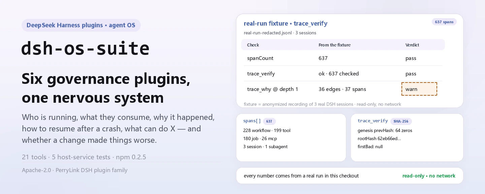
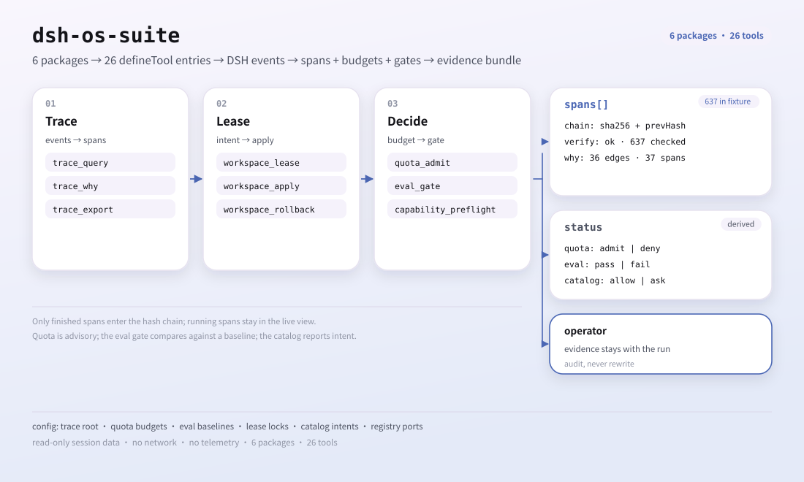

<div align="center">

<picture>
  <source media="(prefers-color-scheme: dark)" srcset="docs/assets/dsh-os-suite-hero-en-dark.webp">
  
</picture>

# dsh-os-suite

**Seis plugins de governança para as camadas que o [DeepSeek Harness](https://github.com/deepseek-ai/deepseek-harness) (DSH) não traz: rastreamento causal, leases de workspace, cotas consultivas, portões de avaliação, catálogo de capacidades e registro de serviços.**

*Quem está rodando, o que consome, por que algo aconteceu, como retomar depois de uma queda, o que pode fazer X e se uma mudança piorou as coisas — 21 ferramentas em seis pacotes com `defineTool`, lógica central offline, 5 testes de integração com serviços do host, publicado como `0.2.5`.*

[English](README.md) · [简体中文](README-zh.md) · [Español](README-es.md) · **Português** · [हिन्दी](README-hi.md)

[](https://github.com/PerryLink/dsh-os-suite/actions/workflows/ci.yml)
[](LICENSE)
[Segurança](SECURITY.md) · [Contribuindo](CONTRIBUTING.md) · [Changelog](CHANGELOG.md)

</div>

> **Projeto comunitário. Sem afiliação, patrocínio ou endosso da DeepSeek.**
> Apache-2.0. Sem SLA, sem garantia. MVP inicial, publicado como `0.2.5` no npm (2026-11-19).

O DSH já tem os órgãos de um agent OS — sessões, ferramentas, loop do agente, sandbox, aprovações, jobs, times, worktrees, MCP. Falta o **sistema nervoso**: quem está rodando, o que consome, por que algo aconteceu, como retomar depois de uma queda, o que pode fazer X e se uma mudança piorou as coisas. Estes seis pacotes cobrem essa camada, não outra pele de UI nem busca de arquivos.

---

## Pacotes

| Pacote | Lacuna | Ferramentas |
|---|---|---|
| [`dsh-os-trace`](packages/dsh-os-trace/) | Auditoria causal e pacotes de evidência à prova de adulteração | `trace_query`, `trace_why`, `trace_export`, `trace_verify` |
| [`dsh-os-lease`](packages/dsh-os-lease/) | Intenções de lease de workspace e planos de transação multiarquivo | `workspace_lease`, `workspace_apply`, `workspace_rollback`, `workspace_status` |
| [`dsh-os-quota`](packages/dsh-os-quota/) | Orçamentos consultivos de token/job/disco e decisões de admissão | `quota_status`, `quota_set`, `quota_admit`, `quota_consume` |
| [`dsh-os-eval`](packages/dsh-os-eval/) | Portões de avaliação de regressão: casos, linhas de base, veredictos de CI | `eval_run`, `eval_gate`, `eval_report` |
| [`dsh-os-catalog`](packages/dsh-os-catalog/) | Catálogo de capacidades por intenção para ferramentas, plugins e MCP | `capability_search`, `capability_preflight`, `capability_register` |
| [`dsh-os-registry`](packages/dsh-os-registry/) | Registro local de serviços e portas para servidores de desenvolvimento | `service_register`, `service_list`, `service_stop` |


<picture>
  <source media="(prefers-color-scheme: dark)" srcset="docs/assets/dsh-os-suite-flow-v5-dark.svg">
  
</picture>

*Estrutura: seis pacotes → 21 ferramentas → uma camada somente leitura; `trace_*` registra a cadeia causal, `workspace_*` planeja e aplica mudanças multiarquivo, `quota_*` decide a admissão, `eval_*` faz o portão contra linhas de base, `capability_*` responde o que pode fazer X e `service_*` acompanha portas locais. Os rótulos do diagrama são os nomes reais de ferramentas e pacotes, então a mesma imagem serve aos cinco idiomas.*

## Status (2026-11-15)

- **276/276 testes passam** (`npm test`; seis pacotes).
- **Proteção de branch**: `main` exige PR, os checks de CI/CodeQL e um branch atualizado; force push e exclusão estão bloqueados.
- **Procedência do release**: os releases publicados no GitHub trazem um asset `.intoto.jsonl` gerado a partir das atestações do npm (manual a partir de `v0.2.4`, automático em releases futuros via `.github/workflows/release-provenance.yml`).
- **Autenticação do release**: npm Trusted Publishing (OIDC), verificado no release `v0.2.5`; o secret legado `NPM_TOKEN` foi removido. Passos e histórico: [`docs/trusted-publishing.md`](docs/trusted-publishing.md).
- **Integração com serviços do host**: cinco testes montam os pacotes reais de serviço do DSH `0.2.2-rc.3` (Cordis Context, ToolRuntime, NativeToolExecutor, SessionStore, SessionProjectionRegistry, SessionQuery, TokenMeter) e verificam negação de cota, spans de trace, leituras ao vivo do eval e pressão do token-meter; rode `npm run test:integration`.
- **Portão de cobertura**: linhas 85% / funções 80% / branches 70% (`npm run test:coverage`).
- **21 ferramentas** se registram via `defineTool`; as seis entradas importam e fazem `apply()` sob um contexto Cordis falso.
- **Nomes verificados**: `npm view <name>` → E404; busca exata de nome no GitHub → 0 (2026-11-15). Ver [NAME-CHECK.md](NAME-CHECK.md).
- **Auditoria pré-release**: [AUDIT.md](AUDIT.md) (histórico, 0.1.x); os três achados foram corrigidos em 0.2.x.
- **Instalação real verificada** em um `DSH_HOME` isolado: os seis tarballs instalam via `dsh plugin --profile web add`, e `--dump-config` lista as seis entradas.
- **Publicado**: os seis pacotes em `0.2.5` no npm (2026-11-19).

## Instalação

```sh
dsh plugin --profile web add dsh-os-trace
dsh plugin --profile web add dsh-os-lease
dsh plugin --profile web add dsh-os-quota
dsh plugin --profile web add dsh-os-eval
dsh plugin --profile web add dsh-os-catalog
dsh plugin --profile web add dsh-os-registry
```

## Início rápido


*Animado: a saída real de `node --test --test-reporter=tap` sobre os seis pacotes (288 testes), `test:integration` (5 testes) e `npm run check:docs` neste checkout em 2026-11-21. A seção de status mantém sua foto de 2026-11-15.*


```sh
npm install
npm test

# inspecionar o tarball de um pacote sem publicar
cd packages/dsh-os-trace && npm pack --dry-run
```

Cada pacote inclui `src/`, `cordis.patch.yml`, `README.md`, `DESIGN.md`, `LICENSE`, e declara `dsh.bundle.patch` + `engines.dsh`.

## Regras de design

- A lógica central (`src/core.js`) **não** importa nenhum `@deepseek-ai/*`; os testes rodam offline.
- A entrada do plugin apenas registra ferramentas e chama o core.
- Cada ferramenta declara `parameters` e `output` schemas explícitos.
- As descrições contam o que o MVP realmente faz; mocks e limites ficam declarados no README de cada pacote.
- Sem rede nem escritas no sistema de arquivos no core; sem segredos.

## Licença

Apache-2.0. Ver o `LICENSE` de cada pacote.
