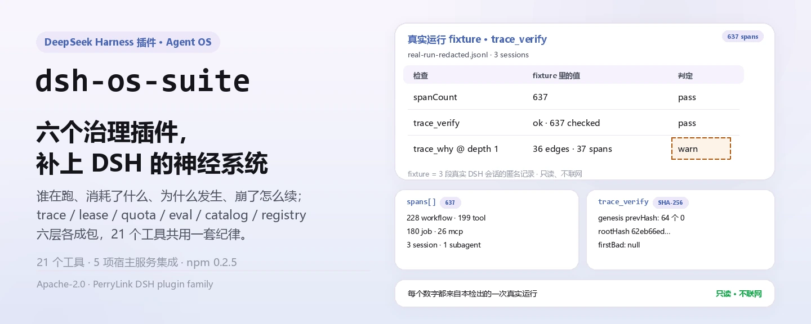
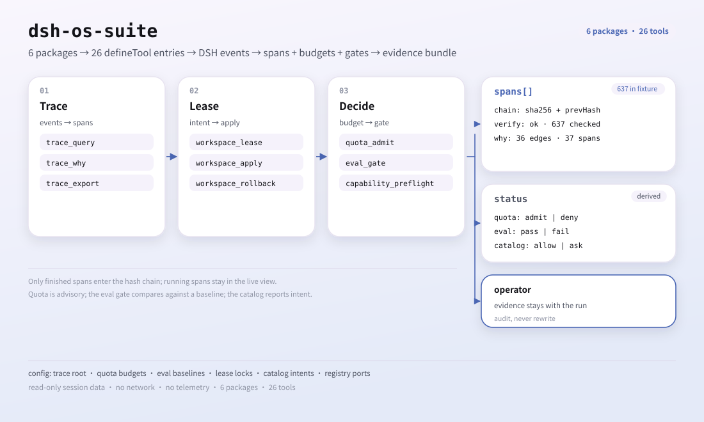

<div align="center">

<picture>
  <source media="(prefers-color-scheme: dark)" srcset="docs/assets/dsh-os-suite-hero-zh-dark.webp">
  
</picture>

# dsh-os-suite

**DSH（[DeepSeek Harness](https://github.com/deepseek-ai/deepseek-harness)）缺的那一层，由六个治理插件补上：因果审计、工作区租约、建议性配额、评测门禁、能力目录与服务登记。**

*谁在跑、消耗了什么、为什么发生、崩了怎么续、谁能做 X、一次改动有没有让事情变糟 —— 六个 `defineTool` 包共 26 个工具，核心逻辑离线可测，另有 5 项宿主服务集成测试，已发布 `0.2.5`。*

[English](README.md) · **简体中文** · [Español](README-es.md) · [Português](README-pt.md) · [हिन्दी](README-hi.md)

[](https://github.com/PerryLink/dsh-os-suite/actions/workflows/ci.yml)
[](LICENSE)
[安全](SECURITY.md) · [贡献](CONTRIBUTING.md) · [变更日志](CHANGELOG.md)

</div>

> **社区项目。与 DeepSeek 无隶属、赞助或背书关系。**
> Apache-2.0，无 SLA、无担保。早期 MVP，已在 npm 发布 `0.2.5`（2026-11-19）。

DSH 已经具备 Agent OS 的器官 —— session、工具、agent 循环、沙箱、审批、job、team、worktree、MCP。它缺的是**神经系统**：谁在跑、消耗了什么、为什么发生、崩了怎么续、谁能做 X、一次改动有没有让事情变糟。这六个包就补这一层，而不是又一个 UI 皮肤或文件检索。

---

## 包含的包

| 包 | 补的缺口 | 工具 |
|---|---|---|
| [`dsh-os-trace`](packages/dsh-os-trace/) | 因果审计与防篡改证据包 | `trace_query`、`trace_why`、`trace_export`、`trace_verify` |
| [`dsh-os-lease`](packages/dsh-os-lease/) | 工作区租约意图与多文件事务计划 | `workspace_lease`、`workspace_apply`、`workspace_rollback`、`workspace_status` |
| [`dsh-os-quota`](packages/dsh-os-quota/) | 建议性 token/job/磁盘预算与准入决策 | `quota_status`、`quota_set`、`quota_admit`、`quota_consume` |
| [`dsh-os-eval`](packages/dsh-os-eval/) | 回归评测门禁：用例、基线、CI 判定 | `eval_run`、`eval_gate`、`eval_report` |
| [`dsh-os-catalog`](packages/dsh-os-catalog/) | 面向工具/插件/MCP 的意图型能力目录 | `capability_search`、`capability_preflight`、`capability_register` |
| [`dsh-os-registry`](packages/dsh-os-registry/) | 面向开发服务器的本地服务与端口登记 | `service_register`、`service_list`、`service_stop` |


<picture>
  <source media="(prefers-color-scheme: dark)" srcset="docs/assets/dsh-os-suite-flow-v5-dark.svg">
  
</picture>

*结构：六个包 → 26 个工具 → 一层只读视图；`trace_*` 记录因果链，`workspace_*` 规划并应用多文件改动，`quota_*` 决定准入，`eval_*` 对照基线做门禁，`capability_*` 回答谁能做 X，`service_*` 追踪本地端口。图内只有真实的工具名与包名，五语共用同一张结构图。*

## 状态（2026-11-15）

- **276/276 项测试通过**（`npm test`；六个包）。
- **分支保护**：`main` 要求 PR、CI/CodeQL 检查通过、分支为最新；禁止强推与删除。
- **发布来源证明**：已发布的 GitHub release 带 `.intoto.jsonl` 资产，由 npm attestation 生成（`v0.2.4`+ 为手工，之后由 `.github/workflows/release-provenance.yml` 自动）。
- **发布鉴权**：npm Trusted Publishing（OIDC），`v0.2.5` release 已验证；旧的 `NPM_TOKEN` secret 已移除。步骤与历史见 [`docs/trusted-publishing.md`](docs/trusted-publishing.md)。
- **宿主服务集成**：五项测试挂载真实 DSH `0.2.2-rc.3` 服务包（Cordis Context、ToolRuntime、NativeToolExecutor、SessionStore、SessionProjectionRegistry、SessionQuery、TokenMeter），验证配额拒绝、trace span、eval 实时读取与 token-meter 压力；运行 `npm run test:integration`。
- **覆盖率门禁**：行 85% / 函数 80% / 分支 70%（`npm run test:coverage`）。
- **26 个工具**通过 `defineTool` 注册；六个入口都能在 fake Cordis context 下 import 并 `apply()`。
- **命名已核验**：`npm view <name>` → E404；GitHub 精确名搜索 → 0（2026-11-15）。见 [NAME-CHECK.md](NAME-CHECK.md)。
- **发布前审计**：[AUDIT.md](AUDIT.md)（历史，0.1.x）；三项发现在 0.2.x 已修复。
- **真实安装已验证**：在隔离的 `DSH_HOME` 中，六个 tarball 都可通过 `dsh plugin --profile web add` 安装，`--dump-config` 列出全部六个条目。
- **已发布**：六个包均为 npm 上的 `0.2.5`（2026-11-19）。

## 安装

```sh
dsh plugin --profile web add dsh-os-trace
dsh plugin --profile web add dsh-os-lease
dsh plugin --profile web add dsh-os-quota
dsh plugin --profile web add dsh-os-eval
dsh plugin --profile web add dsh-os-catalog
dsh plugin --profile web add dsh-os-registry
```

## 快速上手


*动图是 2026-11-21 在本检出里真实运行的终端输出：`node --test --test-reporter=tap` 跑完六个包的测试（288 项，即 `npm test` 所跑的那套）、集成测试（5 项）与 `npm run check:docs`。状态一节保留其 2026-11-15 的快照。*


```sh
npm install
npm test

# 不发布，只查看某个包的 tarball 内容
cd packages/dsh-os-trace && npm pack --dry-run
```

每个包都带 `src/`、`cordis.patch.yml`、`README.md`、`DESIGN.md`、`LICENSE`，并声明 `dsh.bundle.patch` 与 `engines.dsh`。

## 设计规则

- 核心逻辑（`src/core.js`）**不** import 任何 `@deepseek-ai/*`；测试离线运行。
- 插件入口只注册工具并调用 core。
- 每个工具都显式声明 `parameters` 与 `output` schema。
- 描述只写 MVP 真正做的事；mock 与限制写在各自的 README 里。
- core 不联网、不写文件；不含密钥。

## 许可

Apache-2.0。各包的 `LICENSE` 见包目录。
